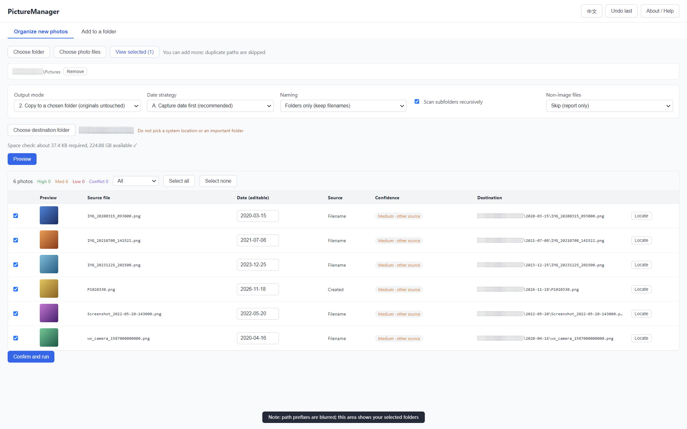
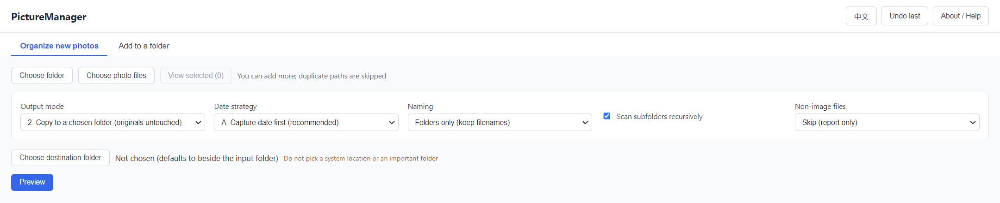
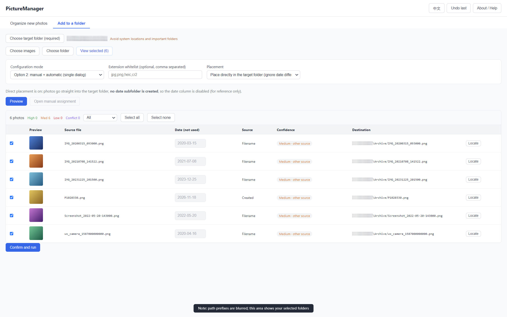
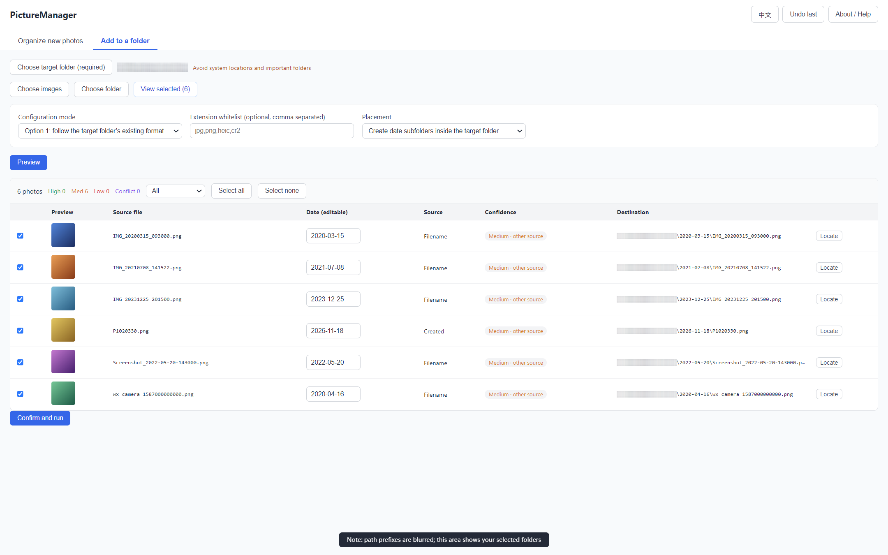
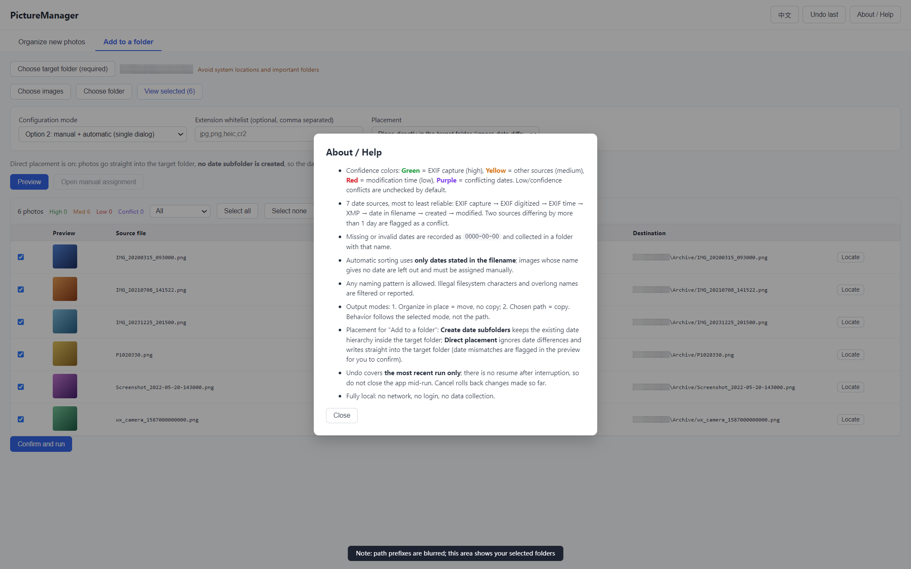

# PictureManager

> **Language / 语言**：English ｜ [简体中文](./README.zh-CN.md)

**A local-only photo organizer that sorts pictures into folders by date.** Scattered photos are grouped into folders like `2020-03-15` based on when they were taken.

No network, no login, no uploads. Copies by default — your originals stay untouched.



## Download

Grab the latest build from [**Releases**](../../releases). Pick one:

| File | Description |
| --- | --- |
| `PictureManager-*-x64.exe` | **Installer (recommended)**. A setup wizard lets you choose the install path; desktop and Start menu shortcuts are created |
| `PictureManager-*-x64.zip` | **Portable build**. Unzip anywhere and run `PictureManager.exe`; no registry entries — deleting the folder is uninstalling |

Both builds have identical features. Windows only for now; macOS and Linux can be built from source (see [Development](#development)).

## UI at a glance

Two side-by-side entry points — choose by scenario:



Three buttons stay in the top-right: **language switch (中 / EN)**, **Undo last**, and **About / Help**. The language switch takes effect immediately and remembers your choice. "About / Help" contains all the rules below, available any time in the app.

---

## 1. Organize new photos

Regroup a messy batch of photos by date.

### 1.1 Pick sources

Click **Choose folder** (optionally including subfolders) or **Choose photo files** (multiple selection). You can add sources repeatedly; duplicate paths are skipped automatically.

Afterwards click **View selected (N)** to inspect every entry — full path, whether it's a file or folder — and remove items, add more, or clear everything.

### 1.2 Choose an output mode

| Mode | Behavior | Originals |
| --- | --- | --- |
| 2. Copy to a chosen folder (default) | Copy into a date folder under the destination | **Untouched** |
| 1. Organize in place | Create date folders beside each source and move files in | Moved from their original position |

Mode 1 **moves** files and cannot be automatically restored; the UI shows an extra warning. Behavior follows the selected mode, not the path.

### 1.3 Other options

- **Date strategy**: `Capture date first` (recommended — EXIF capture time first) / `Save time first` (file created/modified time only; useful when EXIF was stripped)
- **Naming**: `Folders only` (filenames unchanged) / `Folders + rename files` (template, e.g. `{YYYY-MM-DD}_{原文件名}`; supported tokens: `{YYYY-MM-DD}`, `{YYYYMMDD_HHMMSS}`, `{原文件名}`, `{序号}`)
- **Non-image files**: skipped by default; the scan reports how many were found and shows the first few names
- **Disk space check**: mode 2 estimates the required space and warns if there isn't enough

> The Chinese-looking tokens `{原文件名}` and `{序号}` are literal template placeholders in both languages — they must stay exactly as written for renaming to work.

### 1.4 Preview and confirm

Click **Preview** to see the recognition result per photo:


Each row shows a thumbnail, source filename, detected date, **source**, **confidence color**, and the full destination path.

- The date cell is editable; the destination path recalculates immediately
- Filter by confidence, select all / none, or toggle individual rows
- **Low-confidence and conflicting entries are unchecked by default**
- **Locate** opens the original file in Explorer

### 1.5 Run

Click **Confirm and run**. A progress bar and **Cancel** button are shown — cancelling rolls back everything produced by that run.

When done, a report lists succeeded / failed / skipped counts. Problem files are listed with name and full path; nothing is skipped silently.

---

## 2. Add to a folder

Append new photos to an already organized directory.

### 2.1 Pick the target folder

Any writable folder works — no fixed location required. Existing date-folder naming is detected and reused.

### 2.2 Pick the photos to add

Both **Choose images** and **Choose folder** are supported. **View selected (N)** lets you review and adjust the list.

### 2.3 Configuration mode (two options, not either/or)

- **Option 1 · Follow the target folder's existing format**: infer the naming rule from existing date folders
- **Option 2 · Manual + automatic**: a dialog lets you assign a subfolder name to specific photos. Assigned photos leave the automatic pool; the rest are still sorted by timestamp

### 2.4 Placement (important)

This decides whether photos go straight into the target folder or into date subfolders:

| Option | Result |
| --- | --- |
| Create date subfolders inside the target folder | e.g. `Archive/2021-07-08/xxx.jpg` |
| Place directly in the target folder (ignore date differences) | e.g. `Archive/xxx.jpg`, no subfolder created |

With direct placement, dates no longer participate in sorting: the **date column is greyed out and disabled**, its header becomes "Date (not used)", and the manual-assignment dialog is disabled too — so you can't fill in something that would have no effect:



In the default date-subfolder mode, the date column is an editable white input:



---

## Date sources and confidence

A photo's date can hide in many places. The tool tries these **from most to least reliable** and takes the first hit:

| Order | Source | Typical case | Confidence |
| --- | --- | --- | --- |
| 1 | EXIF capture time | Camera / phone originals | 🟢 High |
| 2 | EXIF digitized time | Scans | 🟡 Medium |
| 3 | EXIF time | Re-saved by an editor | 🟡 Medium |
| 4 | XMP sidecar | Lightroom and friends | 🟡 Medium |
| 5 | Date in filename | `IMG_20200315`, `wx_camera_1587…`, `Screenshot_2022-05-20` | 🟡 Medium |
| 6 | File creation time | Images saved from WeChat / QQ | 🟡 Medium |
| 7 | File modification time | Last resort | 🔴 Low |

**Conflict rule**: only the first five (trustworthy) sources are compared; a difference of more than 1 day is flagged 🟣 purple and unchecked by default. Filesystem timestamps do not participate, so screenshots and downloads aren't falsely flagged.

**Invalid dates**: missing or clearly invalid dates go into a `0000-00-00` folder — nothing gets lost.

---

## Safety and undo

- **Undo covers the most recent run only**, clearly labeled. It still works after restarting the app
- **Nothing is written into your photo folders**: the undo manifest lives in the app data directory `%APPDATA%\picture-manager\` — you won't find a `manifest.json` next to your pictures
- Undo verifies target files haven't been modified (SHA256) so files you edited afterwards are never deleted by mistake
- **Do not close the app during a run** — there is no resume. To stop early, use **Cancel**, which rolls back



## FAQ

**Q: Does it connect to the internet or upload my photos?**
No. Everything runs locally and the app contains no network requests.

**Q: Can photos be damaged?**
In the default mode 2, originals are read-only and only copied. Only mode 1 moves files — a rename within the same disk, with no data rewriting.

**Q: Will filenames change?**
Not with `Naming = Folders only`. With `Folders + rename files`, the template applies; illegal characters (`\/:*?"<>|`) are replaced and overlong names are truncated.

**Q: What about duplicate names?**
A number is appended: `IMG_001.jpg` → `IMG_001_1.jpg`. Nothing is overwritten.

**Q: Which formats are supported?**
JPG / JPEG / PNG / GIF / BMP / TIFF / WEBP / AVIF / JXL / HEIC / HEIF, plus RAW: CR2 / CR3 / NEF / ARW / DNG / ORF / RAF / RW2 / PEF / SRW / 3FR / IIQ. Matching `.xmp` sidecars and iPhone Live Photo `.mov` files follow their main image.

**Q: Why did some photos land in `0000-00-00`?**
No trustworthy date was found in EXIF, filename, or creation time. Edit the date in the preview table before running.

**Q: How do I switch languages?**
Click the **中 / EN** button in the top-right. The choice is remembered. All dialogs and error messages follow the selected language.

---

## Development

```bash
npm install          # install dependencies (first run downloads the exiftool binary)
npm run dev          # start in development mode
npm run typecheck    # type check
npm test             # organizer regression tests (placement behavior)
npm run build        # build
npm run dist:win     # package Windows installer + portable zip
```

Stack: Electron + TypeScript + React + Vite; EXIF via exiftool. Interface strings live in `src/shared/i18n.ts` and are shared by the main and renderer processes.

> If packaging stalls while downloading Electron, use `npm run dist:win-dir` (reuses local `node_modules/electron/dist`, no network).
> For a release, push a tag and let GitHub Actions package it: `git tag v1.1.0 && git push --follow-tags`, see `.github/workflows/release.yml`.

## Project structure

```
src/
├── main/          main process: scanning, date detection, organizing, undo manifest
├── preload/       controlled IPC bridge to the renderer
├── renderer/      React UI (preview table, dialogs, help card)
└── shared/        shared types and the Chinese/English message catalog
docs/images/       screenshots for README.zh-CN.md (English in docs/images/en/)
```

## License

MIT © 2026 YyizzLL. See [LICENSE](./LICENSE).
