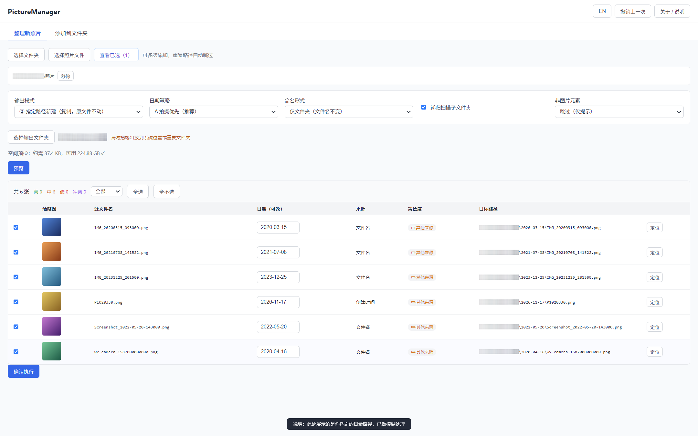
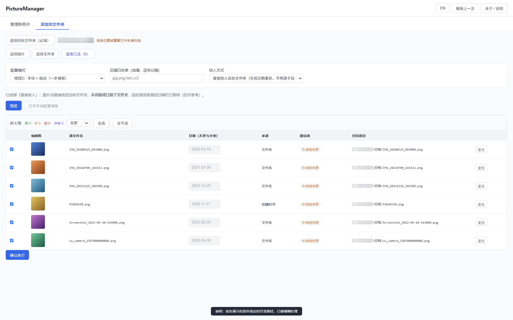
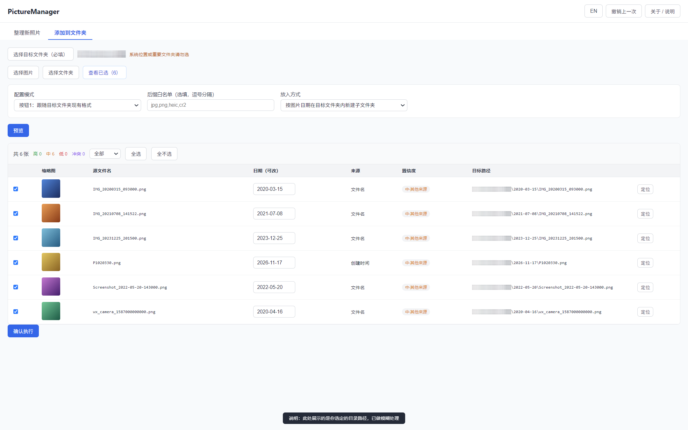
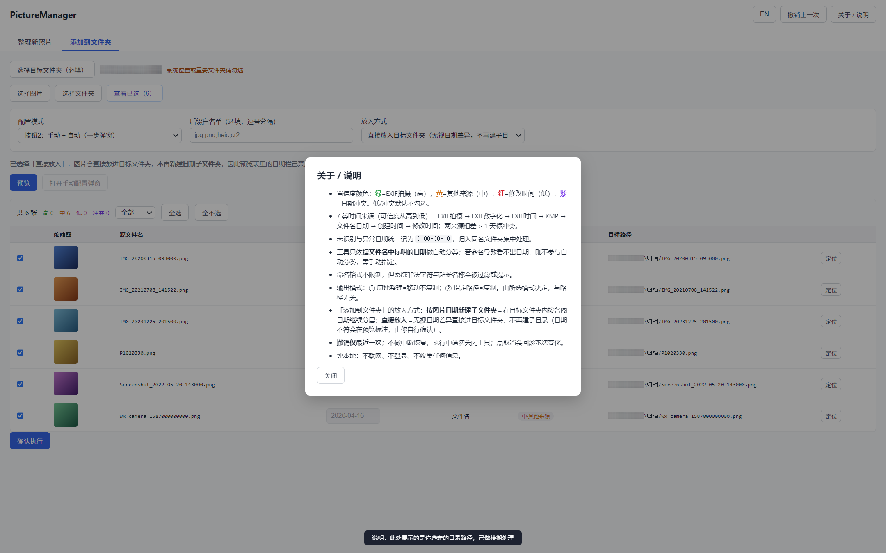

# PictureManager

> **语言 / Language**：简体中文 ｜ [English](./README.md)

**纯本地的照片按日期归档工具。** 把散落在各个文件夹里的照片，按拍摄日期自动收进 `2020-03-15` 这样的日期文件夹。

不联网、不登录、不上传任何数据；默认复制、不动原文件。



## 下载

到 [**Releases**](../../releases) 页面下载最新版，二选一：

| 文件 | 说明 |
| --- | --- |
| `PictureManager-*-x64.exe` | **安装版（推荐）**。双击进入安装向导，安装路径可自选，装完桌面和开始菜单有快捷方式 |
| `PictureManager-*-x64.zip` | **便携版**。解压到任意文件夹，双击 `PictureManager.exe` 即用；不写注册表，删掉文件夹就等于卸载 |

两个包功能完全相同，只是一个装了、一个没装。目前只提供 Windows 版本，macOS / Linux 可从源码构建（见文末「开发」）。

## 界面速览

打开后是两个并列入口，按你的场景选一个：


右上角常驻三个按钮：**中 / EN 语言切换**、**撤销上一次**、**关于 / 说明**。语言切换即时生效并记住你的选择；「关于 / 说明」把下面所有规则都写进了应用里，随时能查。

---

## 一、整理新照片

把一批散乱的照片按日期重新归位。

### 1. 选来源

点 **选择文件夹**（整目录，可选递归子文件夹）或 **选择照片文件**（可多选）。可以反复添加多个来源，重复的路径会自动跳过。

选完点 **查看已选（N）**，能看到每个条目的完整路径、是文件夹还是图片，逐个移除、继续添加或一键清空。

### 2. 选输出方式

| 模式 | 行为 | 原文件 |
| --- | --- | --- |
| ② 指定路径新建（默认） | 复制到目标路径下的日期文件夹 | **完全不动** |
| ① 原地整理 | 在原目录下建日期文件夹，把文件移进去 | 移动后原位置不再有 |

模式①是**移动**，不可自动恢复，选它时界面会额外提示。两种模式只看你点哪个按钮，跟路径位置无关。

### 3. 其他选项

- **日期策略**：`A 拍摄优先`（推荐，先看 EXIF 拍摄时间）／`B 保存时间优先`（只看文件创建/修改时间，适合拍摄时间被清掉的图片）
- **命名形式**：`仅文件夹`（文件名不变）／`文件夹+文件重命名`（可用模板，如 `{YYYY-MM-DD}_{原文件名}`，支持 `{YYYY-MM-DD}`、`{YYYYMMDD_HHMMSS}`、`{原文件名}`、`{序号}`）
- **非图片元素**：默认跳过，扫描结束会提示发现了多少个非图片文件及前几个的名称
- **磁盘空间预检**：模式②会自动估算所需空间，不够会提示

### 4. 预览确认

点 **预览**，逐张列出识别结果：


每一行能看到缩略图、源文件名、识别出的日期、**日期来源**、**置信度颜色**、目标完整路径。

- 日期栏可以直接改，改完目标路径实时重算
- 可以按置信度筛选、全选 / 全不选、单张取消勾选
- **置信度低的默认不勾选**，需要你确认后再执行
- 每行右侧「定位」直接在资源管理器里打开原文件

### 5. 执行

点 **确认执行**。过程中有进度条和 **取消** 按钮——取消会把本次已经产生的变化全部回滚。

完成后弹窗报告成功 / 失败 / 跳过数量，异常图片会列出名称和完整路径，不会静默跳过。

---

## 二、添加到文件夹

往一个已经整理好的目录里追加新照片。

### 1. 选目标文件夹

磁盘上任意可写目录都行，不限定某个固定位置。选完会自动识别该目录现有的命名格式并套用。

### 2. 选要添加的图片

同样支持「选择图片」和「选择文件夹」，**查看已选（N）** 可以核对、增减。

### 3. 配置方式（两个并行，不是二选一）

- **按钮1 · 跟随目标文件夹现有格式**：从目标目录里已有的日期文件夹反推规则，自动套用
- **按钮2 · 手动 + 自动**：弹窗里可以给某几张图**手工指定子文件夹名**，被指定的图片退出自动归类池，其余仍按时间戳自动归入

### 4. 放入方式（关键）

这里决定新图片是**直接躺在目标文件夹里**，还是**再按日期分层**：

| 选项 | 结果 |
| --- | --- |
| 按图片日期在目标文件夹内新建子文件夹 | 例：`归档/2021-07-08/xxx.jpg` |
| 直接放入目标文件夹（无视日期差异） | 例：`归档/xxx.jpg`，不再建子文件夹 |

选了「直接放入」后，日期不再参与分类，所以**日期栏会自动置灰禁用**，表头变成「日期（不参与分类）」；手动配置弹窗也会一并禁用，避免你填了却不生效：



默认「按日期新建子文件夹」时，日期栏是可编辑的白色输入框：



---

## 时间来源与置信度

照片的日期可能藏在很多地方。工具按可信度**从高到低**依次尝试，取第一个命中的：

| 顺序 | 来源 | 典型场景 | 置信度 |
| --- | --- | --- | --- |
| 1 | EXIF 拍摄时间 | 相机、手机原图 | 🟢 高 |
| 2 | EXIF 数字化时间 | 扫描件 | 🟡 中 |
| 3 | EXIF 时间 | 修图软件写过 | 🟡 中 |
| 4 | XMP 旁车文件 | Lightroom 等 | 🟡 中 |
| 5 | 文件名中的日期 | `IMG_20200315`、`wx_camera_1587…`、`Screenshot_2022-05-20` | 🟡 中 |
| 6 | 文件创建时间 | 微信/QQ 存的图 | 🟡 中 |
| 7 | 文件修改时间 | 兜底 | 🔴 低 |

**冲突判定**：只有前 5 类（可信来源）之间相差超过 1 天才算冲突，标成 🟣 紫色，默认不勾选。文件系统时间不参与冲突比对，避免截图、下载图被误报。

**异常日期**：识别不出或明显异常的，统一归入 `0000-00-00` 文件夹，不会丢文件。

---

## 安全与撤销

- **撤销只认最近一次**，按钮旁有标注。关掉软件再打开仍然可用
- **不在你的文件夹里留任何文件**：撤销所需的操作记录存在应用自己的数据目录 `%APPDATA%\picture-manager\`，你的照片文件夹里不会多出 `manifest.json` 之类的文件
- 撤销时会先校验目标文件未被改动过（SHA256），已经被你改过的文件不会被误删
- **执行中不要关闭软件**，工具不做中断恢复；中途想停请用「取消」按钮，它会回滚



## 常见问题

**Q：会联网吗？会上传我的照片吗？**
不会。所有处理都在本机完成，程序不包含任何网络请求。

**Q：照片会被改坏吗？**
默认模式②只读原文件、只做复制。只有你主动选模式①才会移动，且移动是同一磁盘内的重命名操作，不重写数据。

**Q：文件名会变吗？**
「命名形式 = 仅文件夹」时文件名不动。选「文件夹+文件重命名」才会按模板改名，且非法字符（`\/:*?"<>|`）会被替换、超长名称会被截断。

**Q：重名文件怎么办？**
自动加序号：`IMG_001.jpg` → `IMG_001_1.jpg`，不会覆盖。

**Q：支持哪些格式？**
JPG / JPEG / PNG / GIF / BMP / TIFF / WEBP / AVIF / JXL / HEIC / HEIF，以及 RAW：CR2 / CR3 / NEF / ARW / DNG / ORF / RAF / RW2 / PEF / SRW / 3FR / IIQ。同名的 `.xmp` 旁车文件、iPhone 实况照片的 `.mov` 会跟着主图一起归档。

**Q：为什么有些图被归到 0000-00-00？**
说明它的 EXIF、文件名、创建时间里都找不到可信日期。可以在预览表里手动改日期后再执行。

---

## 开发

```bash
npm install          # 安装依赖（首次需联网下载 exiftool 二进制）
npm run dev          # 开发模式启动
npm run typecheck    # 类型检查
npm test             # 执行器回归测试（验证放入方式是否正确落盘）
npm run build        # 构建
npm run dist:win     # 打包 Windows：安装包 exe + 便携版 zip
```

技术栈：Electron + TypeScript + React + Vite，EXIF 读取用 exiftool。

> 打包若卡在从 GitHub 下载 Electron，可改用 `npm run dist:win-dir`（复用本地 `node_modules/electron/dist`，不联网）。
> 正式发布推荐推 tag 让 GitHub Actions 打包：`git tag v1.0.0 && git push --follow-tags`，见 `.github/workflows/release.yml`。

## 目录结构

```
src/
├── main/         主进程：扫描、日期识别、归档执行、清单撤销
├── preload/      预加载：向渲染进程暴露受控 API
├── renderer/     渲染进程：React 界面（预览表、配置弹窗、说明卡片）
└── shared/       主/渲染共享的类型定义与中英词库
docs/images/      README 截图
```

## 许可证

MIT © 2026 YyizzLL。详见 [LICENSE](./LICENSE)。
